<div align="center">

# UART-Controlled System with Multi-Clock Domain

### Complete Digital Flow: RTL → Synthesis → DFT → Formal Verification → PnR


<p>
A UART-commanded SoC subsystem (register file + 16-function ALU) running on <b>two asynchronous clock domains</b>,
taken from RTL through gate-level synthesis, scan insertion and formal equivalence checking.
</p>

| 50 MHz | 3.6864 MHz | 115200 baud | 3 scan chains | 99.32 % | 458 / 458 |
|:---:|:---:|:---:|:---:|:---:|:---:|
| `REF_CLK` | `UART_CLK` | 8E1 UART | 3 × 153 flops | stuck-at test coverage | Formality compare points passing |

</div>

---

## Table of Contents

1. [RTL Design & Verification](#1-rtl-design--verification)
2. [Backend: Synthesis, DFT & Formal Verification](#2-backend-synthesis-dft--formal-verification)
3. [PnR (Place & Route)](#3-pnr-place--route)
4. [Repository Structure](#repository-structure)
5. [Tools & Technology](#tools--technology)

---

## Project at a Glance

| Item | Value |
|---|---|
| Top module | `SYS_TOP` |
| Clock domains | `REF_CLK` 50 MHz (20 ns) · `UART_CLK` 3.6864 MHz (271.27 ns) |
| Generated clocks | `ALU_CLK` (gated `REF_CLK`) · `TX_CLK` = `UART_CLK` ÷ 32 · `RX_CLK` = `UART_CLK` ÷ 1 *(defaults)* |
| Serial protocol | 115200 baud, 8 data bits, even parity (configurable), 1 stop bit |
| Datapath | 22 × 8-bit register file · 8-bit operand / 16-bit result ALU with 15 operations |
| Technology | TSMC 130 nm CL013G standard cells (SS 1.08 V 125 °C · TT 1.2 V 25 °C · FF 1.32 V −40 °C) |
| Synthesized size | 3,212 cells · 33,825 µm² (pre-DFT) → 3,329 cells · 36,940 µm² (post-DFT, +9.2 %) |
| Timing | All setup/hold met, zero violated constraints |
| Equivalence | RTL ≡ netlist ≡ scan netlist, 458 / 458 compare points in every run |
| CDC | 21 clock-domain crossings, **all synchronized**, 0 unsynchronized |

---

# 1. RTL Design & Verification

## 1.1 System Architecture

The host sends command frames over UART. `SYS_CTRL` decodes each command and drives either the **register file** or the **ALU**; replies travel back through an **asynchronous FIFO** to the UART transmitter.

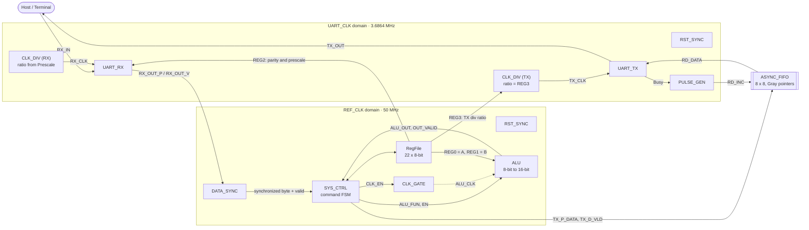

<p align="center">
  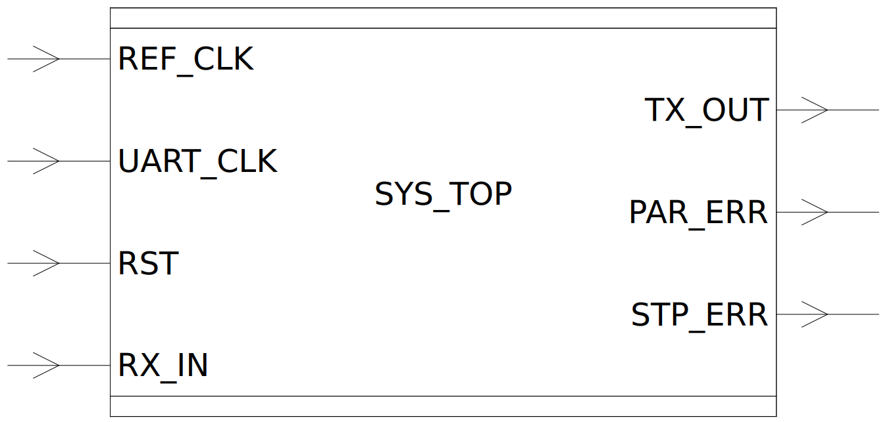<br>
  <sub><b>SYS_TOP</b>: top-level interface (two clocks, async-low reset, serial RX in, serial TX out, parity and stop-bit error flags)</sub>
</p>

<p align="center">
  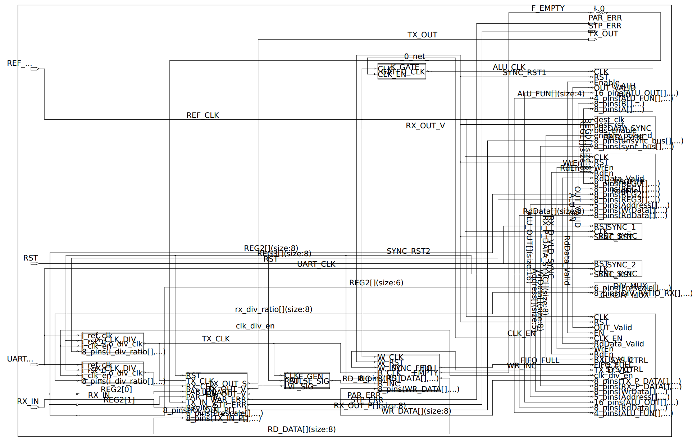<br>
  <sub><b>SYS_TOP</b>: elaborated RTL schematic showing both reset synchronizers, both clock dividers, the UART, FIFO, pulse generator, data synchronizer, register file, ALU, clock gate and controller</sub>
</p>

## 1.2 Command Protocol

Every command is a sequence of UART bytes. The first byte selects the operation.

| Command | Frame (bytes sent) | Reply | Description |
|:---:|---|---|---|
| `0xAA` | `AA` · `ADDR` · `DATA` | none | **Register write** |
| `0xBB` | `BB` · `ADDR` | 1 byte | **Register read** (addresses ≥ 22 are ignored and the FSM returns to idle) |
| `0xCC` | `CC` · `A` · `B` · `FUN` | 2 bytes, LSB first | **ALU with operands**: loads `REG0`/`REG1`, then executes |
| `0xDD` | `DD` · `FUN` | 2 bytes, LSB first | **ALU without operands**: reuses the operands already in `REG0`/`REG1` |

Unknown commands are discarded and the controller returns to idle.

**Register map**

| Address | Name | Reset value | Purpose |
|:---:|---|:---:|---|
| `0x00` | `REG0` | `0x00` | ALU operand **A** |
| `0x01` | `REG1` | `0x00` | ALU operand **B** |
| `0x02` | `REG2` | `0x81` | UART config: `[0]` parity enable · `[1]` parity type (0 = even) · `[7:2]` prescale (32) |
| `0x03` | `REG3` | `0x20` | TX clock divide ratio (32 → `TX_CLK` = 115.2 kHz = baud rate) |
| `0x04`–`0x15` | general purpose | `0x00` | 18 free registers |

**ALU function table** (`FUN` nibble)

| FUN | Operation | FUN | Operation | FUN | Operation |
|:---:|---|:---:|---|:---:|---|
| `0` | `A + B` | `6` | `~(A & B)` NAND | `C` | `A < B` → 3, else 0 |
| `1` | `A − B` | `7` | `~(A \| B)` NOR | `D` | `A >> 1` |
| `2` | `A × B` (16-bit result) | `8` | `A ^ B` XOR | `E` | `A << 1` |
| `3` | `A ÷ B` (÷0 returns 0) | `9` | `~(A ^ B)` XNOR | `F` | no-op (0) |
| `4` | `A & B` | `A` | `A == B` → 1, else 0 | | |
| `5` | `A \| B` | `B` | `A > B` → 2, else 0 | | |

### SYS_CTRL command FSM

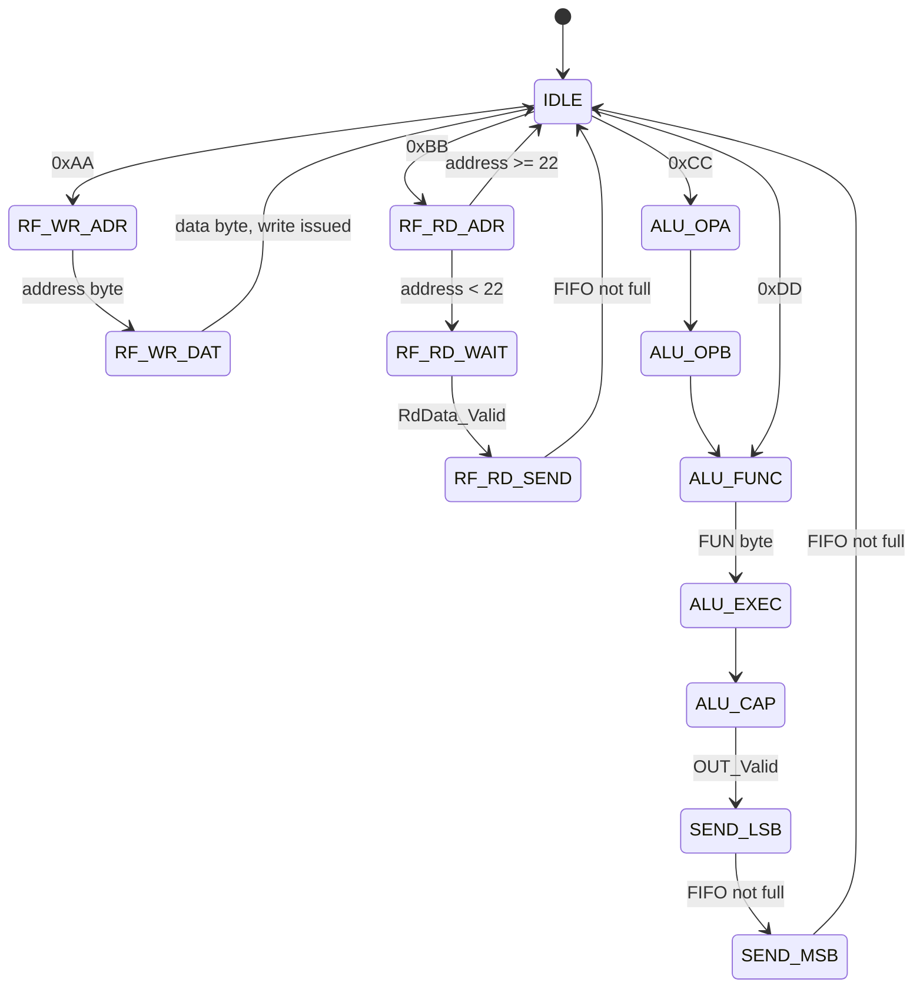

## 1.3 Clocking and Clock-Domain Crossing Strategy

| Crossing | Technique | Module |
|---|---|---|
| Reset (both domains) | Async assert, **synchronous de-assert** (2-flop) | `RST_SYNC` → `DF_SYNC` |
| UART RX byte → `REF_CLK` | **Enable-pulse handshake**: 2-flop sync on the enable, rising-edge detect, then capture the bus | `DATA_SYNC` (`DF_SYNC` + `RISING_EDGE_DETECTOR` + `BUS_CAPTURE`) |
| Response bytes `REF_CLK` → `TX_CLK` | **Asynchronous FIFO**, Gray-coded pointers, 2-flop pointer synchronizers, registered full/empty | `ASYNC_FIFO` |
| TX busy level → FIFO read-increment | Level-to-pulse conversion in the TX domain | `PULSE_GEN` |
| ALU clock | Latch-based glitch-free **clock gate**, enabled only while an ALU command runs | `CLK_GATE` |
| UART baud clocks | Programmable integer dividers (even and odd ratios, bypass at ratio 1) | `CLK_DIV`, `CLKDIV_MUX` |

The RX clock runs at **baud × Prescale**: `CLKDIV_MUX` maps Prescale 8 / 16 / 32 to divide ratios 4 / 2 / 1, so the receiver always oversamples at 8×, 16× or 32× the baud rate and takes a **3-sample majority vote** at mid-bit.

## 1.4 Module Gallery

### Reset, synchronizers and edge detection

<table>
<tr>
<td align="center" width="50%">
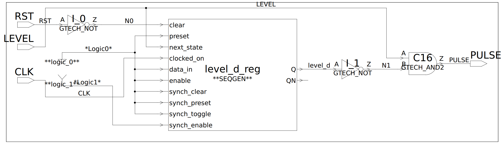<br>
<sub><b>RISING_EDGE_DETECTOR</b>: registered level compared with the live level to make a one-cycle pulse</sub>
</td>
<td align="center" width="50%">
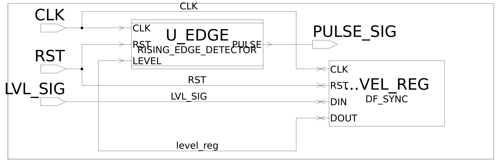<br>
<sub><b>PULSE_GEN</b>: a flop plus the edge detector turns the TX busy level into a FIFO read pulse</sub>
</td>
</tr>
<tr>
<td align="center" colspan="2">
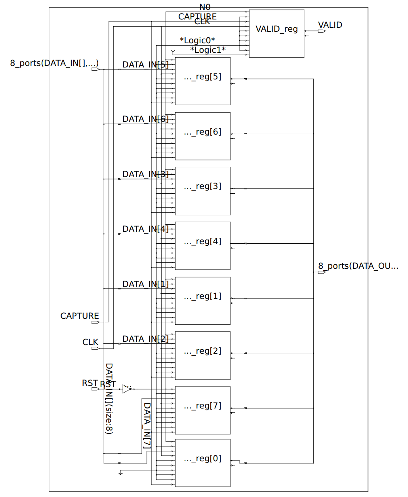<br>
<sub><b>BUS_CAPTURE</b>: eight data flops plus a valid flop, loaded only on the synchronized capture pulse</sub>
</td>
</tr>
</table>

### Clocking

<table>
<tr>
<td align="center" width="50%">
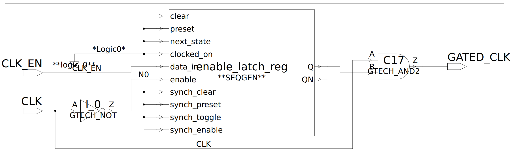<br>
<sub><b>CLK_GATE</b>: enable latch (transparent while the clock is low) feeding an AND gate, so the gated clock can never glitch</sub>
</td>
<td align="center" width="50%">
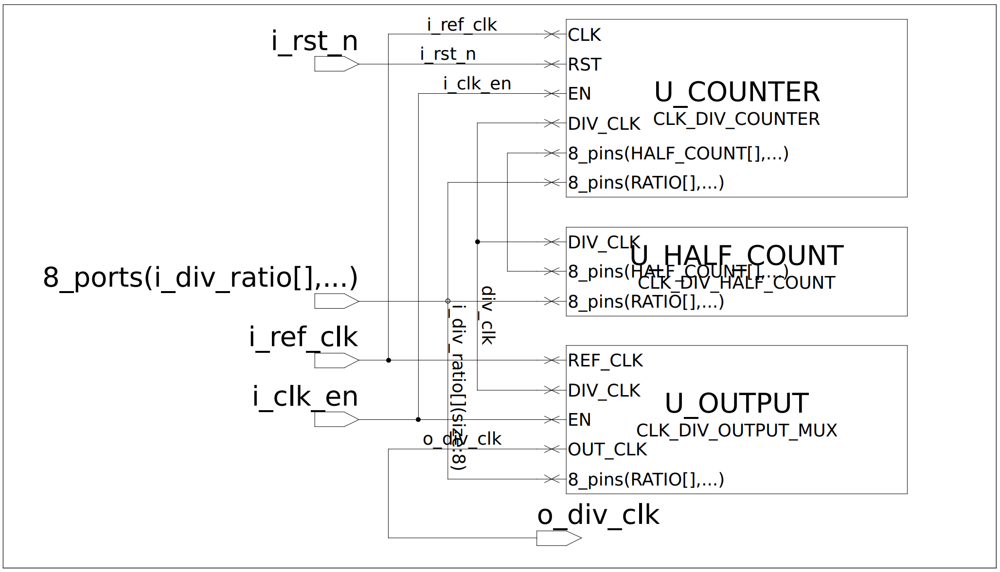<br>
<sub><b>CLK_DIV</b>: divide counter, half-count logic and an output mux that bypasses the divider at ratio 1 or when disabled</sub>
</td>
</tr>
</table>

### Data path

<table>
<tr>
<td align="center" width="50%">
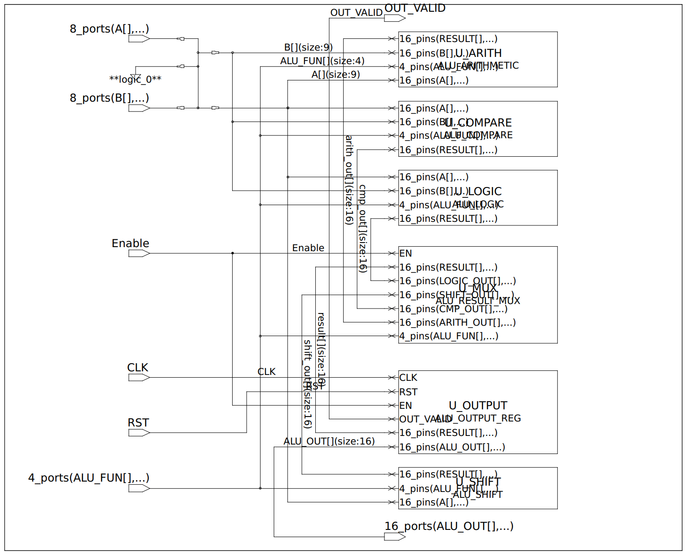<br>
<sub><b>ALU</b>: arithmetic, logic, compare and shift units selected by a result mux and captured in a registered output stage with <code>OUT_VALID</code></sub>
</td>
<td align="center" width="50%">
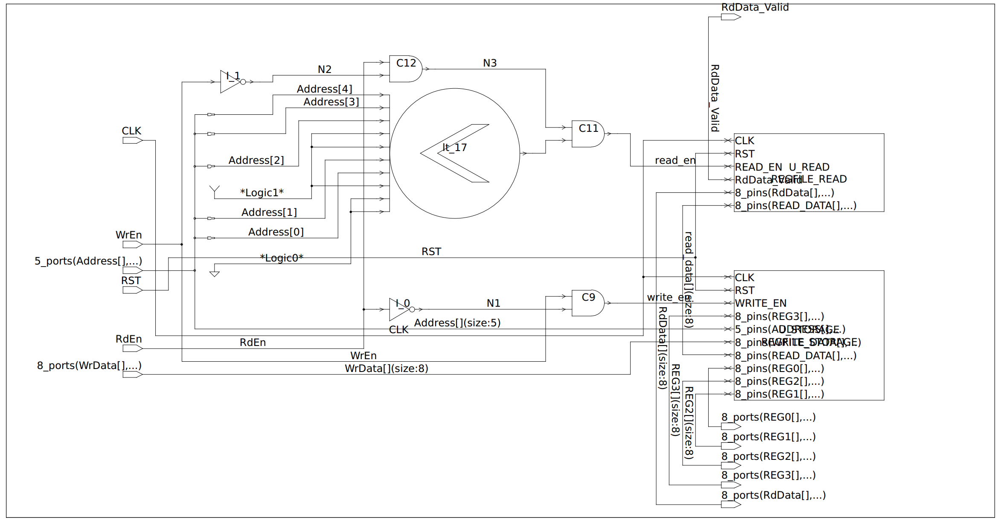<br>
<sub><b>RegFile</b>: storage array with write/read gating and a registered read-valid; <code>REG0</code>–<code>REG3</code> are hard-wired out for the ALU and UART</sub>
</td>
</tr>
<tr>
<td align="center" colspan="2">
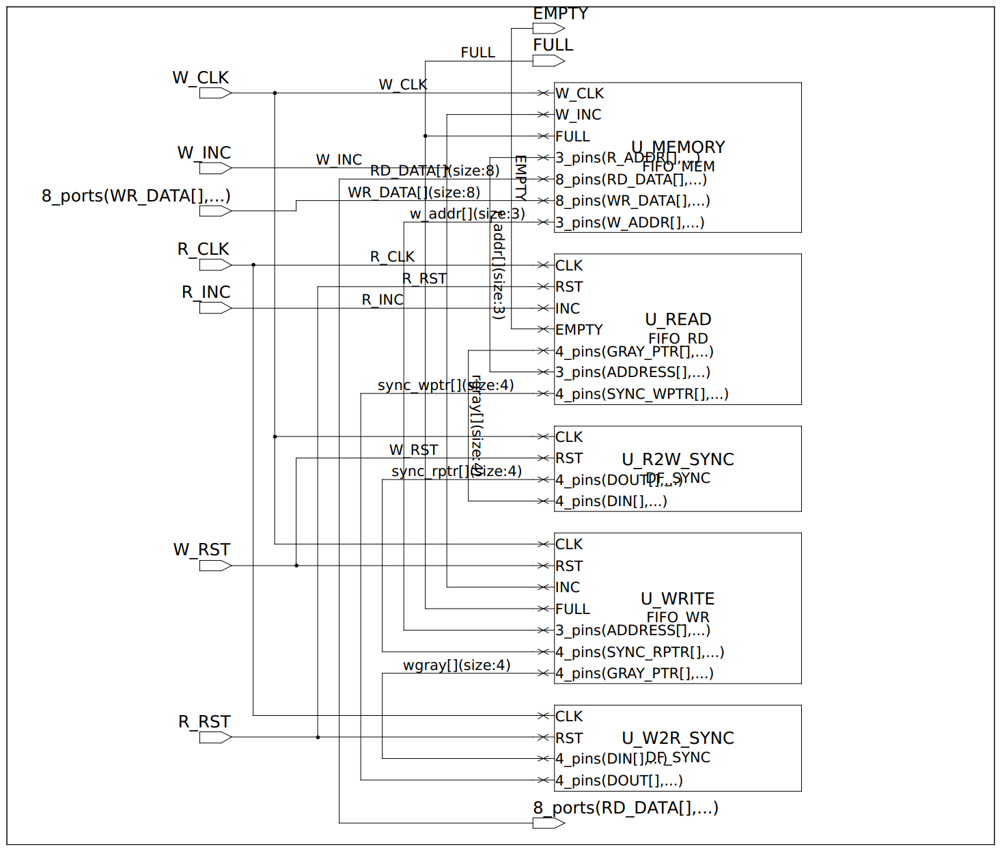<br>
<sub><b>ASYNC_FIFO</b>: write-pointer logic, read-pointer logic, memory and the two Gray-pointer synchronizers (read→write and write→read)</sub>
</td>
</tr>
</table>

### UART

<p align="center">
  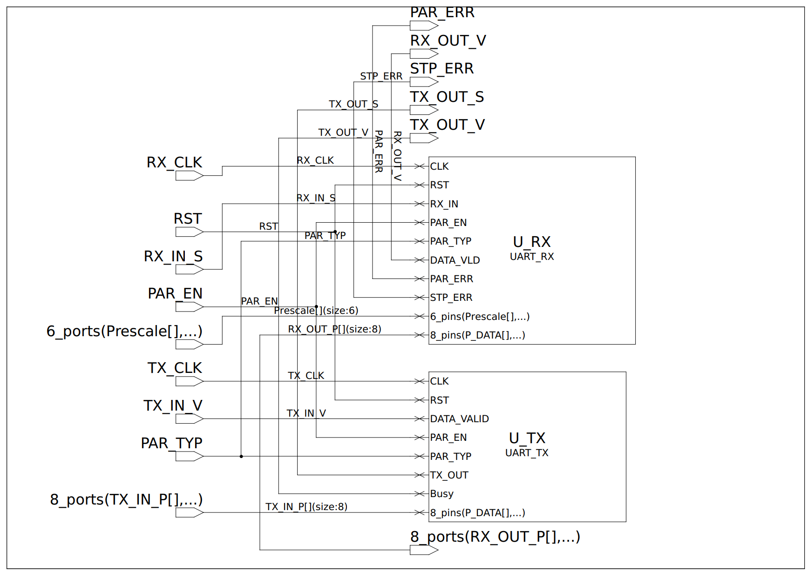<br>
  <sub><b>UART_TOP</b>: independent <code>UART_TX</code> and <code>UART_RX</code> sharing the parity configuration, each on its own divided clock</sub>
</p>

| UART block | Submodules | Notes |
|---|---|---|
| `UART_TX` | `TX_FSM`, `TX_SERIALIZER`, `TX_PARITY_CALC`, `TX_MUX`, `TX_DATA_REG` | Frame: start, 8 data bits (LSB first), optional parity, stop. `Busy` high for the whole frame; new data is accepted only when idle |
| `UART_RX` | `RX_INPUT_SYNC`, `RX_CONFIG_REG`, `RX_FSM`, `RX_EDGE_BIT_COUNTER`, `RX_DATA_SAMPLING`, `RX_DESERIALIZER`, `RX_START_CHECK`, `RX_PARITY_CHECK`, `RX_STOP_CHECK`, `RX_OUTPUT_REG` | 2-flop input synchronizer, start-glitch rejection, parity error and stop error flags, configuration latched at the start of each frame, data only released on a clean frame |

## 1.5 Functional Verification

Every module has its own self-checking testbench, plus integration tests at controller level and at system level. All of them report **zero errors**.

| Testbench | Scope | What it checks |
|---|---|---|
| `ALU_tb` | ALU | All 15 functions plus the undefined code, 23 vectors including overflow (`255 + 255`), underflow (`0 − 1`), `255 × 255 = FE01` and **divide-by-zero returns 0, never X** |
| `RegFile_tb` | Register file | Reset defaults (`0x81`, `0x20`), write and read-back of all 18 general registers, `REG0`–`REG3` outputs, simultaneous read+write rejected, out-of-range read gives no valid, reset restores defaults |
| `ASYNC_FIFO_tb` | FIFO | Empty/full flags after reset, fill to full, **overflow write rejected**, drain with data-order check, underflow read ignored, concurrent write/read of 24 words with unrelated clocks (100 MHz vs 71 MHz), mid-operation reset |
| `CLK_GATE_tb` | Clock gate | Enable changes only take effect on the next cycle, **no glitch** when enable drops while the clock is high |
| `CLK_DIV_tb` | Clock divider | Measured output period for ratios 2, 3, 5, 8 and 32 (even and odd), bypass at ratio 1, bypass when disabled, `CLKDIV_MUX` mapping 8/16/32 → 4/2/1 |
| `DATA_SYNC_tb` | Bus synchronizer | Two bytes crossing with an asynchronous enable: exactly one valid pulse per byte, correct data |
| `PULSE_GEN_tb` | Pulse generator | Exactly one pulse per rising edge of the level input |
| `RST_SYNC_tb` | Reset synchronizer | Asynchronous assertion, synchronous de-assertion after two clocks, re-assertion mid-cycle |
| `UART_TX_tb` | Transmitter | Bit-by-bit frame check for odd/even/no parity with data patterns `A5`, `F3`, `00`, `FF`; input changes during a frame are ignored; reset during a frame |
| `UART_RX_tb` | Receiver | Prescale 8, 16 and 32 × no / even / odd parity (12 of 12 frames received), **start-glitch rejection**, **parity-error injection**, **stop-error injection**, and recovery with a good frame afterwards |
| `UART_TOP_tb` | UART full duplex | Simultaneous transmit and receive at 115200 baud |
| `SYS_CTRL_tb` | Controller integration | UART serial logic bypassed. Configuration writes, register write/read at the first and last address, **all 15 ALU functions**, `DD` operand reuse, **invalid command recovery**, **out-of-range read recovery**: 40 response bytes verified |
| `SYS_TOP_tb` | **Full system** | Real serial frames at 115200 baud on the actual dual-clock design, decoded and parity-checked on `TX_OUT` (7 cases below) |

### System-level test cases (`SYS_TOP_tb`)

| # | Test | Bytes sent | Expected reply | Result |
|:---:|---|---|---|:---:|
| 1 | Configuration writes | `AA 02 81` · `AA 03 20` | none (`REG2 = 81`, `REG3 = 20`) | ✅ |
| 2 | Register write | `AA 04 A7` | none (register 4 = `A7`) | ✅ |
| 3 | Register read | `BB 04` | `A7` | ✅ |
| 4 | ALU with operands: `20 + 5` | `CC 14 05 00` | `19 00` (= `0x0019`) | ✅ |
| 5 | ALU without operands: `20 − 5` | `DD 01` | `0F 00` (= `0x000F`) | ✅ |
| 6 | Multiply: `255 × 255` | `CC FF FF 02` | `01 FE` (= `0xFE01`) | ✅ |
| 7 | AND: `F3 & 0F` | `CC F3 0F 04` | `03 00` (= `0x0003`) | ✅ |

The testbench also fails on any unexpected `PAR_ERR`/`STP_ERR`, checks the start, parity and stop bits of every reply frame, and has a global timeout. ModelSim transcript: `ALL TESTS PASSED`, `errors=0`.

### Waveforms

<p align="center">
  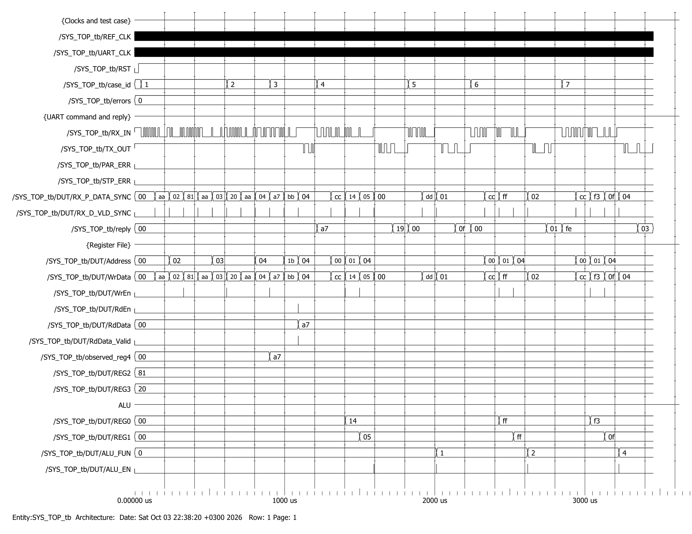<br>
  <sub><b>Full system simulation</b>: all seven cases from one run. Serial frames on <code>RX_IN</code>, decoded bytes on <code>RX_P_DATA_SYNC</code>, register file activity, ALU operands/function, and the reply bytes on <code>TX_OUT</code></sub>
</p>

<table>
<tr>
<td align="center" width="50%">
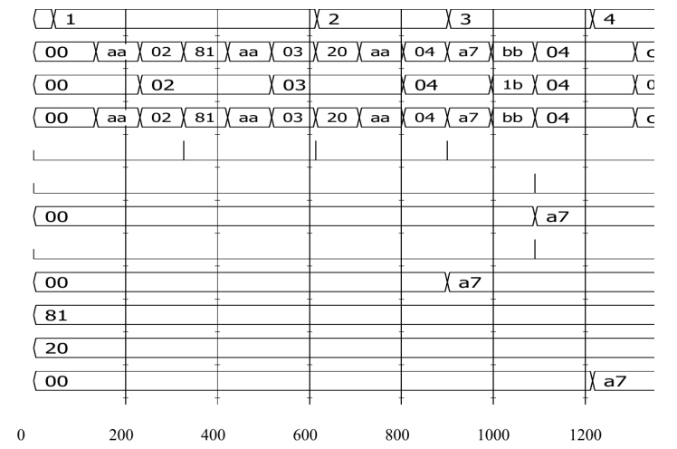<br>
<sub><b>Cases 1–3</b>: configuration, register write (<code>observed_reg4</code> changes <code>00 → A7</code>) and register read (<code>RdData_Valid</code>, reply <code>A7</code>)</sub>
</td>
<td align="center" width="50%">
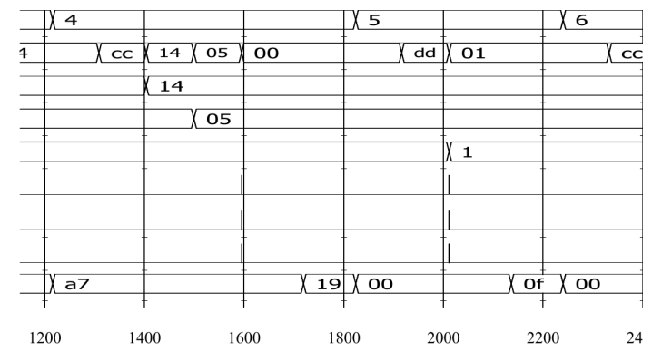<br>
<sub><b>Cases 4–5</b>: addition with new operands, then subtraction reusing the stored operands via <code>DD</code></sub>
</td>
</tr>
<tr>
<td align="center" colspan="2">
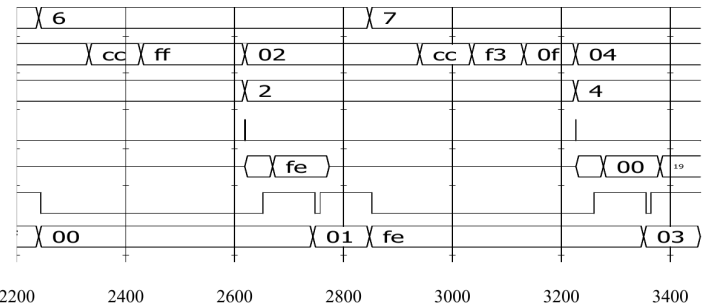<br>
<sub><b>Cases 6–7</b>: <code>255 × 255</code> returns both result bytes (<code>01</code> then <code>FE</code>), and a bitwise AND</sub>
</td>
</tr>
</table>

### Running the simulation

```tcl
# In ModelSim, from rtl/01_Design_and_Verification
do run.do
```

`run.do` compiles `source_files.f` and `tb_source_files.f`, loads `SYS_TOP_tb`, applies `wave.do` and runs to completion. To run any single block, compile `source_files.f` plus that block's `*_tb.v`.

## 1.6 Static Checks: Lint & CDC (SpyGlass)

| Check | Result |
|---|---|
| Scalar clock-domain crossings | 8 found, **8 synchronized**, 0 unsynchronized |
| Vector clock-domain crossings | 13 found, **13 synchronized**, 0 unsynchronized |
| Quasi-static crossings | 14 (the static configuration bits from `REG2` / `REG3`) |
| Asynchronous resets | 2, each with a reset synchronizer, both with **synchronous de-assertion** |
| Unsynchronized / re-converging async resets | 0 / 0 |
| Registers missing a clock definition | 0 |

The only latch in the design is the intentional clock-gate latch. It is kept `dont_touch` and mapped to the library clock-gating cell during implementation (see Backend). Reports are in `rtl/02_Reports/Lint` and the SpyGlass session in `rtl/03_Tool_Outputs/SpyGlass`. Constraints are in `system.sgdc` and `waiver.awl`.

---

# 2. Backend: Synthesis, DFT & Formal Verification

## 2.1 Flow

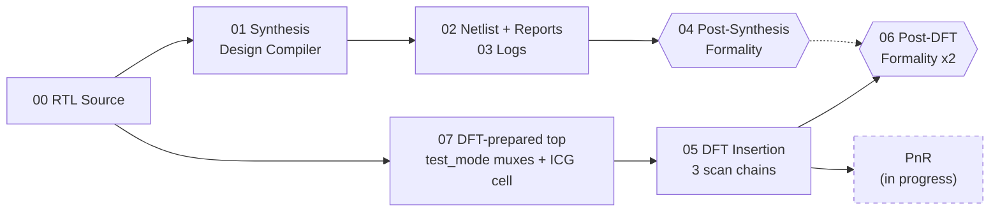

| Folder | Stage | Contents |
|---|---|---|
| `00_RTL_Source` | Input | Frozen RTL used by the flow |
| `01_Synthesis_Scripts_and_Constraints` | Synthesis | `syn_script.tcl`, `cons.tcl` (SDC-style constraints), file list, logs |
| `02_Synthesis_Netlist_and_Reports` | Synthesis outputs | Gate netlist, SDC, SDF, SVF, `.ddc` and area / power / timing / clock / constraint reports |
| `03_Synthesis_Log_File` | Logs | `syn.log`, `command.log`, `default.svf` |
| `04_Post_Synthesis_Formality` | Verification | RTL vs gate netlist |
| `05_DFT_Netlist_and_Reports` | DFT | `dft_script.tcl`, scan netlist, scan SDC and functional SDC, test protocol (`.spf`), DRC, coverage, scan paths, clock checks, all reports |
| `06_Post_DFT_Formality` | Verification | Two equivalence runs covering the DFT step |
| `07_System_Top_After_DFT_Preparation` | DFT input | `SYS_TOP_dft.v` (adds scan ports and `test_mode` clock/reset muxes) and `CLK_GATE_ICG.v` (instantiates the library ICG cell) |

## 2.2 Constraints (`cons.tcl`)

| Constraint | Setting |
|---|---|
| Clocks | `REF_CLK` 20 ns · `UART_CLK` 271.27 ns (3.6864 MHz) |
| Generated clocks | `ALU_CLK` (÷1, through the clock gate) · `TX_CLK` (÷32) · `RX_CLK` (÷1) |
| Clock groups | `{REF_CLK, ALU_CLK}` ⟂ `{UART_CLK, TX_CLK, RX_CLK}` declared **asynchronous** |
| Uncertainty | 0.2 ns setup · 0.1 ns hold; 0.05 ns clock transition |
| I/O delay | `RX_IN` input delay 20 % of the RX period; `TX_OUT` / `PAR_ERR` / `STP_ERR` output delay 20 % of their clock periods |
| Reset | `RST` set as false path (asynchronous, re-timed by `RST_SYNC`) |
| Driving cell / load | `BUFX2M` on `RX_IN` · 0.1 pF on outputs |
| Corners | Setup/target library: **SS 1.08 V 125 °C** · Hold: **FF 1.32 V −40 °C** |
| Protection | Clock network `dont_touch`; clock-gate cell `dont_touch`; hold fixing enabled on all clocks |

## 2.3 Synthesis Results

| Metric | Value |
|---|---|
| Total cells | 3,212 (2,675 combinational · 483 sequential · 608 buffers/inverters) |
| Total cell area | **33,825 µm²** (combinational 21,958 · sequential 11,867) |
| Constraint violations | **None** (`constraints.rpt`) |
| Estimated power | 0.301 mW total at the SS corner (0.273 mW internal · 6.2 µW switching · 21.3 µW leakage), low-effort estimate with unannotated activity |

**Largest area contributors**

| Block | Area (µm²) | Share |
|---|---:|---:|
| ALU divider | 8,972 | 26.5 % |
| Register file | 7,916 | 23.4 % |
| Async FIFO | 3,568 | 10.5 % |
| ALU multiplier | 2,362 | 7.0 % |
| SYS_CTRL | 1,903 | 5.6 % |
| 2 × CLK_DIV | 2,239 | 6.6 % |

**Timing (worst slack per clock group, synthesis)**

| Clock group | Setup slack (ns) | Hold slack (ns) |
|---|---:|---:|
| `REF_CLK` (20 ns) | 15.98 | 0.09 |
| `ALU_CLK` (20 ns) | 0.00 *(met; combinational divider is the critical path)* | 0.18 |
| `UART_CLK` | 267.22 | 0.07 |
| `RX_CLK` | 215.92 | 0.06 |
| `TX_CLK` | 6,942.63 | 0.09 |

## 2.4 Backend Tests and Checks

Every stage ends with explicit checks. This is what is verified and where the evidence lives.

### A. Synthesis integrity checks (inside `syn_script.tcl`)

| Test | Pass criterion | Result |
|---|---|:---:|
| RTL `analyze` / `elaborate` / `link` | no errors, script exits otherwise | ✅ |
| `check_design` before and after `compile` | only benign warnings (tie-offs on DesignWare cells, one unused port bit) | ✅ |
| No unmapped `GTECH` cells | script aborts if any remain | ✅ |
| No stray latches (`TLATNX*` / `TLATX*`) | script aborts if any remain; only the intentional ICG remains | ✅ |
| `check_timing` | generated clocks, loops, unconstrained endpoints, partial I/O delay all checked, no issues | ✅ |
| `report_constraint -all_violators` | "This design has no violated constraints" | ✅ |
| Setup and hold timing (`setup.rpt`, `hold.rpt`) | all groups MET | ✅ |

### B. Post-synthesis equivalence (`04_Post_Synthesis_Formality`)

| Check | Reference | Implementation | Result |
|---|---|---|---|
| Formality (SVF-guided) | RTL | Synthesized gate netlist | **SUCCEEDED**: 458 / 458 compare points pass, 0 failing, 0 aborted, 0 unverified, 0 unmatched |
| DesignWare pre-verification | RTL `div` / `mult` | Mapped `DW_div_uns` / `DW02_mult` | **SUCCEEDED** for both |

### C. DFT checks (`05_DFT_Netlist_and_Reports`)

| Test | Result |
|---|---|
| **Pre-DFT design-rule check** (`pre_dft_drc.rpt`) | 0 violations; 459 of 460 sequential cells are valid scan cells, the 1 exception is the clock-gating cell (intentionally non-scan) |
| **Scan architecture preview** (`preview_dft.rpt`) | 3 chains, full-scan, multiplexed-flip-flop style, clock domains not mixed |
| **Scan insertion** (`scan_paths.rpt`) | 3 balanced chains of **153 cells** each (`SI[0..2]` → `SO[0..2]`, shared `SE`, `scan_clk`) |
| **Post-DFT design-rule check** (`post_dft_drc.rpt`) | **0 violations**: clock rules, scan-chain rules, X-state, tri-state, compression rules all clean |
| **Fault coverage estimate** (`dft_coverage.rpt`) | **99.32 % stuck-at test coverage** over 25,034 faults (22,026 detected · 2,857 undetectable · 101 ATPG-untestable · 49 not detected · 1 possibly detected) |
| **DFT signal check** (`dft_signals.rpt`) | `scan_clk` (100 ns, 45/55 timing), active-low `scan_rst`, `test_mode` constant 1 in all modes |
| **Scan-mode timing** (`test_mode = 1`) | Setup slack +75.38 ns · hold slack +0.08 ns on `SCAN_CLK`; no violated constraints |
| **Functional-mode timing** (`test_mode = 0`, `SE = 0`) | All groups met; hold ≥ +0.09 ns; no violated constraints; `check_timing_functional` and `case_analysis_functional` reports included |
| **Clock check** (`clock_check/`) | Re-runs functional clocks on the final scan netlist: `clocks`, `check_timing`, `case_analysis`, `disabled_timing`, **clock-mux connection report** (verifies every `test_mode` clock mux), setup and hold |

**DFT cost**

| | Pre-DFT | Post-DFT | Overhead |
|---|---:|---:|---:|
| Cells | 3,212 | 3,329 | +3.6 % |
| Area (µm²) | 33,825 | 36,940 | **+9.2 %** |

**DFT design notes**

- `test_mode` muxes every functional clock (`REF_CLK`, `UART_CLK`, `ALU_CLK`, `TX_CLK`, `RX_CLK`) and the resets onto a single `scan_clk` / `scan_rst`, so all 459 flops shift together.
- The clock gate is implemented with the library integrated clock-gating cell `TLATNCAX12M` (`CLK_GATE_ICG.v`), excluded from the scan chains.
- Scan ports added: `scan_clk`, `scan_rst`, `test_mode`, `SE`, `SI[2:0]`, `SO[2:0]`.

### D. Post-DFT equivalence (`06_Post_DFT_Formality`)

Two runs, both with `test_mode = 0`, `SE = 0`, `scan_rst = 1`, `scan_clk = 0` applied as constants and the scan-out ports excluded from comparison.

| Run | Reference | Implementation | Proves | Result |
|---|---|---|---|---|
| `preparation_equivalence` | Original RTL | DFT-prepared RTL (`SYS_TOP_dft.v` + ICG) | The test-mode wrapper does **not** change functional behaviour | **SUCCEEDED**: 458 / 458 |
| `dft_fm` | DFT-prepared RTL | Final scan netlist | Scan insertion and incremental compiles did **not** change functional behaviour | **SUCCEEDED**: 458 / 458 |

Chain of trust: **original RTL ≡ DFT-prepared RTL ≡ scan netlist (functional mode)**, with 0 failing, 0 aborted and 0 unverified points in every run.

## 2.5 Results Summary

| Stage | Check | Result |
|---|---|:---:|
| Synthesis | Violated constraints | **0** |
| Synthesis | Setup / hold | All met |
| Formality | RTL vs gate netlist | **458 / 458** |
| DFT | DRC violations (pre and post) | **0** |
| DFT | Scan chains | 3 × 153 |
| DFT | Stuck-at test coverage | **99.32 %** |
| DFT | Scan-mode and functional-mode timing | Met |
| Formality | RTL vs DFT-prepared RTL | **458 / 458** |
| Formality | DFT-prepared RTL vs scan netlist | **458 / 458** |

## 2.6 Reproducing the Flow

Each stage is run from inside its own folder (scripts resolve paths relative to their location):

```bash
cd Backend/01_Synthesis_Scripts_and_Constraints
dc_shell -f syn_script.tcl            # synthesis → 02_Synthesis_Netlist_and_Reports

cd ../04_Post_Synthesis_Formality
fm_shell -f syn_fm_script.tcl         # RTL vs netlist

cd ../05_DFT_Netlist_and_Reports
dc_shell -f dft_script.tcl            # scan insertion → scan netlist, SDCs, SPF

cd ../06_Post_DFT_Formality
fm_shell -f prep_fm_script.tcl        # original RTL vs DFT-prepared RTL
fm_shell -f dft_fm_script.tcl         # DFT-prepared RTL vs scan netlist
```

> The scripts expect the TSMC CL013G libraries at the `LIB_DIR` path set at the top of each script. Edit it for your environment.

---

# 3. PnR (Place & Route)

> **Status: 🚧 In progress.** This folder is reserved for the physical-design stage and will be filled in as the flow is completed.

**Inputs already prepared by the Backend flow**

| Input | File |
|---|---|
| Gate-level netlist with scan | `Backend/05_DFT_Netlist_and_Reports/SYS_TOP.v` |
| Functional constraints | `Backend/05_DFT_Netlist_and_Reports/SYS_TOP_functional.sdc` |
| Scan-mode constraints | `Backend/05_DFT_Netlist_and_Reports/SYS_TOP_scan.sdc` |
| Test protocol | `Backend/05_DFT_Netlist_and_Reports/SYS_TOP.spf` |
| Timing libraries | TSMC CL013G SS / TT / FF |

**Planned deliverables**

- [ ] Floorplan and power planning
- [ ] Placement and scan-chain reordering
- [ ] Clock-tree synthesis (REF_CLK, UART_CLK and the generated `ALU_CLK` / `TX_CLK` / `RX_CLK`)
- [ ] Routing
- [ ] Post-route timing, DRC and LVS
- [ ] Post-layout equivalence check and final GDSII

---

## Repository Structure

```text
.
├── rtl/                                  # 1. RTL design & verification
│   ├── 01_Design_and_Verification/
│   │   ├── ALU/ ASYNC_FIFO/ CLK_GATE/ Clock_Divider/ Common/
│   │   ├── DATA_SYNC/ PULSE_GEN/ RegFile/ RST_SYNC/ SYS_CTRL/ SYS_TOP/
│   │   ├── UART/ {UART_TX, UART_RX, UART_TOP}
│   │   │      (each block: RTL/ + <block>_tb.v)
│   │   ├── run.do  wave.do  source_files.f  tb_source_files.f
│   │   └── system.sgdc  waiver.awl  Lint.prj  spyglass-1.prj
│   ├── 02_Reports/                       # Lint, simulation waveform, verification report
│   └── 03_Tool_Outputs/                  # ModelSim and SpyGlass session output
│
├── Backend/                              # 2. Synthesis, DFT, formal verification
│   ├── 00_RTL_Source/
│   ├── 01_Synthesis_Scripts_and_Constraints/
│   ├── 02_Synthesis_Netlist_and_Reports/
│   ├── 03_Synthesis_Log_File/
│   ├── 04_Post_Synthesis_Formality/
│   ├── 05_DFT_Netlist_and_Reports/
│   ├── 06_Post_DFT_Formality/
│   └── 07_System_Top_After_DFT_Preparation/
│
├── PnR/                                  # 3. Place & route (in progress)
├── Docs/
│   ├── Images/                           # Schematic / symbol PDFs
│   │   └── PNG/                          # PNG renders used in this README
│   └── Simulation/                       # Waveform figures used in this README
└── LICENSE                               # Apache-2.0
```

## Tools & Technology

| Purpose | Tool / version |
|---|---|
| RTL simulation | ModelSim Intel FPGA Edition 10.5b |
| Lint and CDC | Synopsys SpyGlass L-2016.06 |
| Logic synthesis and DFT | Synopsys Design Compiler O-2018.06-SP1 |
| Equivalence checking | Synopsys Formality L-2016.03-SP1 |
| Standard-cell library | TSMC 130 nm CL013G (`scmetro_tsmc_cl013g_rvt`) |

## License

Released under the [Apache License 2.0](LICENSE).

## Author

**Essam Elkholy**: final project of a Digital IC Design Diploma.
GitHub: [@Essam-Elkholy](https://github.com/Essam-Elkholy)
